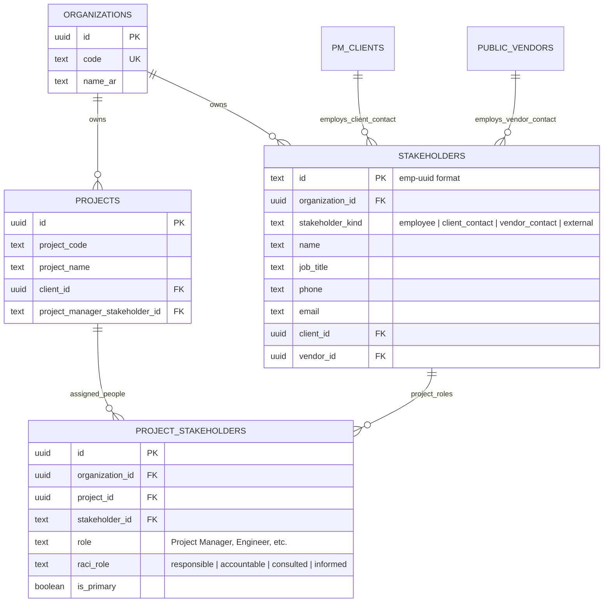

# STAKEHOLDER_REDESIGN_PRD.md
# Product Requirements Document (PRD) — Stakeholders & RACI Matrix System

**System Target:** PZone Portal ERP (Next.js 15 / Supabase PostgreSQL / React 19)  
**Document Version:** 1.0.0 (Phase 1 Approved)  
**Status:** Approved for Implementation  
**Author:** Antigravity AI Architecture Team  
**Date:** 2026-08-10  

---

## 1. Executive Summary & Product Vision

### 1.1 Purpose
The **Stakeholders & RACI Matrix System** establishes a unified, enterprise-grade person registry and operational responsibility framework for PZone ERP. It resolves historical data drift where project team members were un-structured strings, client/vendor representatives lacked central registry, and RACI responsibilities were un-tracked per project.

### 1.2 Core Pillars
1. **Universal Person Registry (`public.stakeholders`):** Single source of truth for **all individual human beings** involved in PZone projects — Internal Employees, Client Contacts, Vendor/Subcontractor Representatives, and External Specialists.
2. **Project Stakeholders Hub (`public.project_stakeholders`):** Explicit project-to-person junction table linking individuals to specific projects with assigned project roles (e.g. *"Project Manager"*, *"Site Engineer"*) and operational RACI responsibilities.
3. **Single Accountable Constraint (Scope A RACI):** Strict enforcement that a project can have **at most one `accountable` person** overall (Project Manager), while allowing multiple `responsible`, `consulted`, or `informed` personnel.
4. **Governance vs. Execution Separation:** Static Corporate RACI Matrix (in `/user-management` Admin page) remains company policy; `project_stakeholders` governs live project execution.

---

## 2. User Personas & Target Roles

```
┌──────────────────────────────────────────────────────────────────────────┐
│ USER PERSONAS                                                            │
├───────────────────┬──────────────────────────────────────────────────────┤
│ System Admin      │ Manages corporate governance matrix, audits          │
│                   │ universal person registry, configures access roles.  │
├───────────────────┼──────────────────────────────────────────────────────┤
│ Project Manager   │ Accountable person for assigned project. Defines     │
│ (Accountable)     │ project team assignments, assigns RACI roles.        │
├───────────────────┼──────────────────────────────────────────────────────┤
│ Team Member       │ Responsible / Consulted / Informed person. Views     │
│ (Executer)        │ assigned tasks, project roles, and contact info.     │
└───────────────────┴──────────────────────────────────────────────────────┘
```

---

## 3. Scope Comparison & Phase 1 Boundary

| Concept | Status | Description |
|---|---|---|
| **Phase 1 Model (Scope A)** | **IN SCOPE** | **Project-Level RACI:** At most 1 `accountable` person per project overall. Universal Person Registry using text-PK (`public.stakeholders`). Additive multi-tenant base (`public.organizations`). |
| **Scope B (Process-Level)** | **FROZEN (Future)** | Process-granular RACI mapping (`raci_process_key`). Deferred until UI requires process-level dropdowns. |
| **Scope C (WBS-Level)** | **FROZEN (Future)** | Task-granular RACI mapping (`wbs_id`). Deferred until WBS module activation. |
| **RLS Hardening** | **DEFERRED** | Preserves existing RLS policies; multi-tenant RLS deferred to Phase 2. |

---

## 4. Functional Requirements (FR)

### FR-1: Universal Stakeholder Registry (`/stakeholders`)
- **FR-1.1:** System MUST display a unified person directory listing all registered stakeholders.
- **FR-1.2:** Each stakeholder MUST belong to one of 4 explicit kinds (`stakeholder_kind`):
  1. `employee`: Internal PZone employee (company: PZone Group).
  2. `client_contact`: Client representative (linked to `pm.clients`).
  3. `vendor_contact`: Vendor / Subcontractor representative (linked to `public.vendors`).
  4. `external`: External consultant, specialist, or authority contact.
- **FR-1.3:** Registry MUST display full person name, job title, department, display company name, phone, email, active status, and count of assigned projects.

### FR-2: Relational Integrity & Data Validation Constraints
- **FR-2.1:** System MUST enforce database CHECK constraint `chk_stakeholder_kind_relations`:
  - `employee` MUST have `client_id IS NULL` AND `vendor_id IS NULL`.
  - `client_contact` MUST have `client_id IS NOT NULL` AND `vendor_id IS NULL`.
  - `vendor_contact` MUST have `vendor_id IS NOT NULL` AND `client_id IS NULL`.
  - `external` MUST have `client_id IS NULL` AND `vendor_id IS NULL`.

### FR-3: Project Team & Stakeholders Hub (`/projects/[id]` -> Team Tab)
- **FR-3.1:** Replaces legacy flat team view with structured Stakeholders Hub.
- **FR-3.2:** Displays assigned persons grouped by party (PZone Internal Team, Client Team, Vendor/Subcontractor Team, External Specialists).
- **FR-3.3:** Shows project role (e.g. *"Project Manager"*, *"Quality Engineer"*) and RACI badge (`A`, `R`, `C`, `I`).

### FR-4: Single Accountable Person Constraint
- **FR-4.1:** Database MUST enforce `CREATE UNIQUE INDEX uq_project_accountable ON public.project_stakeholders(project_id) WHERE raci_role = 'accountable';`.
- **FR-4.2:** System MUST prevent assigning a second `accountable` person to the same project. Attempting to assign a second `accountable` person MUST throw a clear user-facing error.

### FR-5: Project Lifecycle & RACI Nullability
- **FR-5.1:** `raci_role` MUST be optional/nullable during draft project creation (`status = 'tender'` / `'not_started'`).
- **FR-5.2:** Application UI & service validation MUST require an `accountable` person to be assigned before transitioning project status to `active` / `working`.

### FR-6: Security Invoker Reporting Views
- **FR-6.1:** System MUST provide `public.stakeholders_full` exposing full person profiles, company name resolution, and aggregated assigned projects JSON.
- **FR-6.2:** System MUST provide `public.stakeholder_project_register` exposing project assignment registry.
- **FR-6.3:** Both views MUST use `WITH (security_invoker = true)` to respect caller RLS context.

---

## 5. Non-Functional Requirements (NFR)

- **NFR-1: Zero Data Loss:** 100% preservation of all 233 existing `public.stakeholders` rows, 71 `pm.projects` rows, 37 `pm.clients` rows, 34 `pm.project_manager_aliases` rows, and 71 `pm.project_manager_history` rows.
- **NFR-2: Performance & Scalability:** Directory page (`/stakeholders`) and Project Team Tab MUST render in under **100ms** by utilizing indexed joins (`idx_project_stakeholders_proj`, `idx_project_stakeholders_stk`).
- **NFR-3: Backward Compatibility:** Retains existing `id text PRIMARY KEY` (`'emp-...'`) on `public.stakeholders` so no application API contracts or existing payload mappers break.
- **NFR-4: PostgREST Safety:** Payload mappers (`buildCreatePayload`, `buildUpdatePayload`) MUST use strict `ALLOWED_SET` allow-lists. Non-existent columns (such as `client`) MUST NEVER be sent to PostgREST.
- **NFR-5: Reversibility:** Migration MUST be 100% reversible via `007_stakeholders_phase1_redesign_undo.sql` without dropping original employee or project data.

---

## 6. System Architecture & Entity Relationships



---

## 7. User Interface Specifications

### 7.1 Stakeholders Directory Screen (`/stakeholders`)
- **Header:** "دليل الأشخاص والأطراف المعنية" (Stakeholders Directory) + Search Box + "إضافة شخص" (Add Stakeholder) Button.
- **Filter Tabs:** All (الكل) | Employees (الموظفون) | Client Reps (ممثلو العملاء) | Vendor Reps (ممثلو المقاولين) | External (خبراء خارجيون).
- **Data Table Columns:**
  1. **الاسم (Name):** Full Arabic name + Employee Code badge.
  2. **الجهة / الشركة (Company):** Display company name with icon (PZone, Client Name, Vendor Name, External).
  3. **المسمى الوظيفي (Job Title):** Job title + Department.
  4. **بيانات التواصل (Contact):** Phone + Email icons.
  5. **المشاريع المرتبطة (Assigned Projects):** Count pill (e.g. `3 مشاريع`).
  6. **الحالة (Status):** Active (نشط) / Inactive (غير نشط).

### 7.2 Project Team Tab (`/projects/[id]` -> Team Tab)
- **RACI Legend Header:** 
  - `A` - Accountable (المسؤول الأول والنهائي - max 1)
  - `R` - Responsible (المسؤول عن التنفيذ)
  - `C` - Consulted (مستشار)
  - `I` - Informed (مُبَلّغ)
- **Section Cards:**
  - **فريق إدارة المشروع (PZone Project Team):** List of assigned PZone employees with role & RACI badge.
  - **ممثل المالك والحيود (Client Representatives):** Assigned client contacts.
  - **مقاولين الباطن والموردين (Subcontractor / Vendor Contacts):** Assigned vendor contacts.

---

## 8. Release & Delivery Roadmap

```
Phase 0: Read-Only Audit & Baseline ✅ COMPLETED
  └─ Verified row counts, schemas, and live database facts. Created LIVE_SCHEMA_BASELINE.md.

Phase 0.1: Canonical Data Decisions Audit ✅ COMPLETED
  └─ Evaluated Option A vs B. Confirmed pm.clients as canonical client table. Created CANONICAL_DATA_DECISIONS.md.

Phase 1 DDL: Database Migration Package ⏳ READY FOR APPLY
  └─ 007_stakeholders_phase1_redesign.sql prepared. Awaiting owner command to apply to remote Supabase.

Phase 1 UI: App Code Updates 🚀 QUEUED AFTER DDL
  └─ Update TypeScript types, project services, Team Tab component, and create /stakeholders directory page.
```
