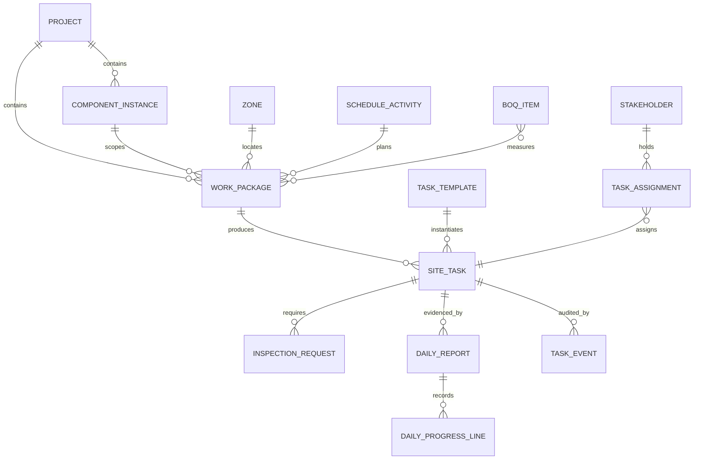
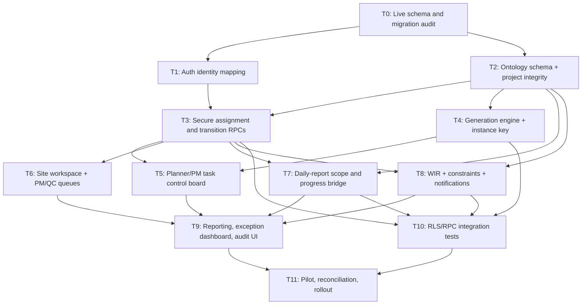

# PRD — Project Task Ontology & Engineering Graph

**Product:** Pzone Construction ERP  
**Area:** Planning → Site Execution → PM Review → QC/WIR → Verified Progress  
**Status:** Build-ready specification; no live database deployment assumed  
**Owner decision supported:** For each project, what work must happen, where, by whom, by when, what has been verified, and what needs intervention now?

---

## 1. Problem and outcome

The current `pm_site_tasks` core makes a task visible to an assignee, but it does not safely model repeated project scope, schedule-driven execution, scoped daily reports, or accountable approval.

The target is a controlled task instance, not a generic to-do item:

```text
Approved schedule activity + BOQ scope + component instance + zone
                         ↓
                    Work package
                         ↓
             Site task / inspection task
                         ↓
       Daily report and evidence from assigned engineer
                         ↓
         PM decision → QC/WIR decision → verified quantity
                         ↓
  Activity progress, look-ahead, weekly report, and executive exceptions
```

Success means a planner can generate the same library step for two lagoons in the same project without collision; a site engineer can report only work assigned to them and inside the task scope; and every approval is attributable, auditable, and role-safe.

## 2. Scope

### In scope

- A task ontology for project-specific construction execution.
- Manual and schedule/library-derived task creation.
- Repeated component/zone instances within one project.
- Site execution, PM review, QC/WIR inspection, rejection, rework, and closure.
- Daily-report scope validation and progress derivation.
- Role- and identity-enforced RPCs/RLS.
- Task event audit, notifications, calendar/board/queue views, and exception KPIs.
- Tests, migration ordering, and live-schema verification.

### Out of scope for this release

- Full procurement package workflow, cost forecasting, payroll, or payment certificates.
- Automatic NLP BOQ-to-activity matching. Keep suggested linking as a later P2 capability.
- Consultant external portal. Consultant inspection can be represented as a task party until a dedicated portal is approved.

## 3. Personas and accountable decisions

| Persona | Must decide / do | Cannot do |
|---|---|---|
| Planning engineer | create work packages and tasks from approved schedule; assign/replan | approve PM or QC outcome unless explicitly delegated |
| Project manager | accept/reject submitted execution; resolve overdue scope | impersonate QC inspection |
| Site engineer | start assigned tasks; report quantity/evidence; submit for PM review | edit task scope, reassign, approve own work |
| QC inspector | accept/reject assigned inspection/WIR with evidence | approve an unassigned inspection |
| Admin | manage delegation, role assignment, exception override | bypass audit trail |

## 4. Ontology method

The implementation uses an operational ontology: each entity has one business meaning, a stable identifier, declared relations, permitted state changes, and source-of-truth fields. Titles are display data, never keys.

### 4.1 Identity rules

| Concept | Stable identity | Notes |
|---|---|---|
| Project | existing `projects.id` | Security and ownership boundary. |
| Schedule activity | existing `pm_project_activities.id` plus schedule version | Only approved baseline/current version may create scheduled work. |
| BOQ item | existing `pm_boq_items.id` | Quantity/cost scope, never inferred from title. |
| Zone | existing `pm_zones.id` | Physical location hierarchy. |
| Component instance | new `pm_component_instances.id` | Example: `Lagoon 1`, `Pump Room B`; solves repeated scope. |
| Work package | new `pm_work_packages.id` | Project-specific, controlled execution scope. |
| Library step/template | existing library row ID/code | Definition only; not a project task. |
| Task | `pm_site_tasks.id` and immutable `task_instance_key` | A specific execution obligation. |
| Inspection request | new `pm_inspection_requests.id` | One or more inspections for a task; separate from daily progress. |
| Daily report | existing `pm_daily_progress.id` | Evidence record, not the task itself. |
| Event | new `pm_task_events.id` | Immutable explanation of a task change. |

### 4.2 Relationship graph



### 4.3 Cardinality and invariants

1. Every work package and task belongs to exactly one project.
2. Every component instance and zone referenced by a work package belongs to that project.
3. A task has exactly one primary assignee. It may have zero or more watchers/delegates.
4. A task may have zero or more BOQ scopes and activity scopes through bridge tables. Do not store multi-value text IDs.
5. A report must reference one task. Every report line must be within that task's BOQ/activity/zone scope, unless a PM override event records why.
6. `task_instance_key` is unique per project. It is composed from project, component instance, zone, template/step, and revision — never title.
7. Actual progress is derived from approved report quantities or an explicitly selected measurement method. It is not a freely editable percentage.
8. A rejection must contain a reason at the database boundary.
9. State changes, date changes, reassignments, and scope changes create immutable events.

## 5. Data model

### 5.1 New/changed tables

| Object | Minimum fields | Purpose |
|---|---|---|
| `stakeholders` change | `auth_user_id uuid unique references auth.users(id)` | Durable user-to-person identity. Backfill once; stop email lookup for authorization. |
| `pm_component_instances` | `id, project_id, code, name_ar, component_type, zone_id, status` | Repeated physical units in one project. |
| `pm_work_packages` | `id, project_id, code, title_ar, component_instance_id, zone_id, schedule_activity_id, planned_start, planned_finish, status, revision` | Controlled planning scope. |
| `pm_work_package_boq_scope` | `work_package_id, boq_item_id, planned_qty, unit` | Many-to-many measurable BOQ scope. |
| `pm_site_tasks` change | `task_instance_key, work_package_id, template_id, planned_start_at, planned_finish_at, actual_start_at, actual_finish_at, measurement_method, progress_source` | Project task instance. Retain current IDs where feasible. |
| `pm_task_assignments` | `id, task_id, stakeholder_id, role, assigned_by, assigned_at, released_at` | Primary assignee, PM reviewer, QC inspector, watcher, delegate. |
| `pm_inspection_requests` | `id, task_id, request_no, inspection_type, required_at, assigned_qc_id, status, decision_at, decision_by, reason` | Planned WIR/QC lifecycle. |
| `pm_task_events` | `id, task_id, event_type, actor_user_id, actor_stakeholder_id, from_state, to_state, payload jsonb, created_at` | Append-only task audit. |
| `pm_notifications` | `id, recipient_user_id, event_type, entity_type, entity_id, occurred_at, read_at` | Real inbox and escalation delivery. |
| `pm_task_constraints` | `id, task_id, type, title, owner, required_by, status, resolved_at` | Material, drawing, access, approval, weather, or safety blocker. |

### 5.2 Task fields and source of truth

| Field | Owner/source | Rule |
|---|---|---|
| Planned dates | approved schedule/work package | Replan through controlled RPC; preserve original baseline dates. |
| Actual dates | transition events | Set server-side when started/completed. |
| Scope | work package bridges | Changes create new revision/event. |
| Assignee/QC | task assignment | Must map to `auth_user_id` and project access. |
| Reported quantity | daily report lines | Raw evidence only. |
| Verified quantity | approved report/inspection decision | Drives physical task progress. |
| Percent complete | derived | `verified_qty / planned_qty × 100`, capped only by measurement policy. |
| Status | transition RPC | Direct client state update prohibited. |

### 5.3 Cross-project integrity

Foreign keys alone do not prove all linked records share the task project. Implement database triggers/functions that reject a task/work-package insert or update when its zone, component, BOQ, activity, assignee, or inspector is outside the same project or has no valid project access.

## 6. Workflow and state graph

### 6.1 Execution task

```mermaid
stateDiagram-v2
  [*] --> planned
  planned --> released: planner releases
  released --> in_progress: assigned engineer starts
  in_progress --> submitted_for_pm: report/evidence submitted
  submitted_for_pm --> rework: PM rejects with reason
  submitted_for_pm --> inspection_pending: PM accepts and WIR needed
  submitted_for_pm --> verified: PM accepts; no inspection required
  inspection_pending --> rework: QC rejects with reason
  inspection_pending --> verified: assigned QC accepts
  rework --> in_progress: engineer restarts
  verified --> closed: quantity/criteria complete
  planned --> cancelled: planner/PM cancels with reason
  released --> cancelled
  in_progress --> cancelled
```



### 6.2 Who may transition

| Transition | Actor | Mandatory evidence |
|---|---|---|
| `planned → released` | planning engineer / PM | valid assignee, scope, date, project access |
| `released → in_progress` | primary assignee | authenticated identity match |
| `in_progress → submitted_for_pm` | primary assignee | report/evidence and reported quantity where measurable |
| `submitted_for_pm → rework` | assigned PM/delegate | rejection reason |
| `submitted_for_pm → inspection_pending` | assigned PM/delegate | assigned QC and inspection required date |
| `inspection_pending → verified` | assigned QC/delegate | decision, evidence, verified quantity/criteria |
| `inspection_pending → rework` | assigned QC/delegate | rejection reason |
| `verified → closed` | PM or system rule | completion criteria satisfied |
| `* → cancelled` | planning manager / PM | cancellation reason |

The database RPC must check actor identity, assignment, current project access, valid source state, and required evidence. Client-side role checks are presentation only.

## 7. Functional requirements

### FR-01 — Project task control board

Create `/planning/site-tasks` for planners and PMs.

- Select project, approved schedule version, component instance, zone, status, owner, and period.
- List/kanban/calendar views. The list is the authoritative operating view.
- Create manual task, edit allowed planning metadata, release, reassign, replan, cancel, split, and create inspection request.
- Drill: project → work package → task → report/inspection/event evidence.
- Show baseline date, current planned date, actual date, owner, verified quantity, constraints, and source IDs.

### FR-02 — Schedule/library generation

- Select project + component instance + zone + approved schedule activity or work package.
- Preview proposed rows with dates, scope, assignee, QC requirement, and duplicate result.
- Generate only using `task_instance_key` uniqueness.
- Re-running the same input is idempotent; a different component/zone produces a different task set.
- Use project work calendar and activity duration/relationships. Do not assign one arbitrary calendar day per library row.
- Do not generate from unapproved schedule versions unless an explicit planning draft mode is approved.

### FR-03 — Site workspace

Retain `/site-workspace`, but read assignments from `pm_task_assignments` using `auth_user_id`.

- My tasks: overdue/today/tomorrow/later, grouped by project and zone.
- Start, update evidence, submit report, submit for PM review, see rejection reason.
- No controls for scope, direct status edit, reassignment, or direct percentage override.
- Offline drafts may be stored locally but must reconcile through normal server validation.

### FR-04 — PM and QC queues

- PM queue: every task where current state is `submitted_for_pm` and actor is assigned PM/delegate.
- QC queue: every inspection where current state is `inspection_pending` and actor is assigned QC/delegate.
- Each queue has due date, aging, scope, linked report/evidence, approve/reject action, and reason modal.
- Approval cannot be executed by a user who performed the same task unless an auditable approved exception is enabled.

### FR-05 — Daily-progress integration

- Task remains mandatory for daily report creation.
- Report creation checks report author is assigned to the task or has recorded delegated authority.
- Each line is validated against the task's BOQ/activity/zone scope.
- Report date outside task planned window creates a visible exception; it does not silently change plan dates.
- Approved quantities aggregate server-side into task verified quantity and activity progress according to measurement method.

### FR-06 — Inspection/WIR

- A task may require zero, one, or many inspection requests.
- PM acceptance can create WIR automatically using configured lead time, or planner can create it manually.
- Rejected WIR reopens task to rework and can create a constraint/obstruction link.
- WIR decision remains independent from the daily report's historical inspection fields; migration/backfill must preserve existing data.

### FR-07 — Notifications and escalation

Create notifications for assignment, reassignment, task due within one working day, overdue task, submitted PM review, scheduled QC receipt, rejection, and blocked constraint.

Escalation thresholds are provisional until business approval:

| Exception | Default recipient | Provisional threshold |
|---|---|---|
| Task overdue | assignee + PM | planned finish < today and not verified/closed |
| PM review aged | PM + planning manager | > 1 working day |
| QC inspection aged | QC + PM | required inspection date passed |
| Unassigned released task | planning manager | immediate |

## 8. Security and audit requirements

1. Add `stakeholders.auth_user_id`; backfill and validate one active stakeholder per authenticated user before enabling task writes.
2. Revoke client `UPDATE` on task status/scope/assignment. Expose controlled RPCs only.
3. Every security-definer function sets a safe `search_path`, checks `auth.uid()`, validates project membership, and checks the exact assignment/role needed.
4. A QC role/permission must be explicit. Do not reuse `technical_office` as a broad QC substitute without an explicit delegation record.
5. Event rows are append-only to normal users. No event update/delete policy.
6. Task, report, WIR, and notification RLS use the same project-access function and test matrix.
7. Database rejection reasons, assignment validity, state transitions, and cross-project scope checks are mandatory; UI validation is supplementary.

## 9. KPIs and operational graph queries

All KPIs use an explicit as-of date, project filter, and task status definition. Missing scope/data is reported as `N/A`, not zero.

| KPI | Formula / grain | Decision |
|---|---|---|
| Released-task completion | verified or closed tasks ÷ released tasks, by project/week | Is site delivery happening? |
| On-time verification | tasks verified on/before planned finish ÷ verified tasks | Is planned work reliable? |
| PM review aging | now − first `submitted_for_pm` event | Where must PM intervene? |
| QC aging | now − inspection required date | Which receipt risks work stoppage? |
| Rework rate | tasks entering `rework` ÷ tasks submitted for PM/QC | Where is quality failing? |
| Scope coverage | task BOQ/activity scoped rows ÷ released tasks | Which work cannot support progress control? |
| Unassigned exposure | released tasks without primary assignee | What will fail tomorrow? |

Primary executive visual: ranked exception table. Each row shows project, task/work package, owner, overdue days, stage, blocker, and linked schedule/BOQ IDs. Do not use a standalone RAG status without raw measures.

## 10. Engineering implementation graph



### Delivery tasks

| ID | Deliverable | Depends on | Acceptance |
|---|---|---|---|
| T0 | Inventory live tables/functions/policies; confirm migration 017 state | — | Signed migration plan; no assumptions about production schema. |
| T1 | `auth_user_id` identity mapping and backfill tooling | T0 | Every active task actor resolves to one active stakeholder. |
| T2 | Component/work-package/task/event/inspection schema and integrity triggers | T0 | Cross-project references rejected by SQL tests. |
| T3 | Secure create/release/transition/reassign/replan/cancel RPCs | T1,T2 | Unauthorized actor and invalid transition tests fail. |
| T4 | Generator rewrite with preview and `task_instance_key` | T2 | Same step generates in two zones; re-run same instance creates zero duplicates. |
| T5 | `/planning/site-tasks` planner/PM control board | T3,T4 | PM can create/release/reassign/replan/cancel with audit. |
| T6 | Site workspace, PM queue, QC queue | T3 | Each role sees only own actionable queue. |
| T7 | Task-scoped report bridge and verified-progress calculation | T2,T3 | Out-of-scope report line rejected; verified quantity drives task progress. |
| T8 | WIR, constraints, notification event handlers | T2,T3 | QC receives only assigned inspections; rejection produces rework/event. |
| T9 | Exception views/KPIs/audit drill-through | T5-T8 | Totals reconcile to task/report source data at declared cut-off. |
| T10 | Database and UI integration tests | T3,T4,T7,T8 | Security, workflow, multi-zone, and failure-path coverage passes. |
| T11 | Pilot one live project; reconciliation and rollout | T9,T10 | Planner, PM, site, QC sign off on actual workflow. |

## 11. Migration strategy

1. **Do not alter live data blindly.** T0 must inspect the live schema, deployed function signatures, and RLS policies first.
2. Add tables/columns additively. Keep old `pm_site_tasks` fields during migration.
3. Backfill identity mappings with a review queue for unmatched/duplicate email records.
4. Add project-integrity triggers in warning/audit mode only if existing data is inconsistent; remediate then enforce.
5. Deploy secure RPCs and update UI to use them before revoking broad direct updates.
6. Backfill task events with `migration_backfill` type only where source facts exist; never invent historic actor/time facts.
7. Reconcile daily report links, inspection fields, and existing task statuses before enabling the derived-progress rule.
8. Pilot using a non-critical project or controlled project subset, then enable policy enforcement.

## 12. Acceptance scenarios

1. Planner generates `LB-014` for Lagoon 1/Zone A and Lagoon 2/Zone B. Both task sets exist; re-running Lagoon 1 creates none.
2. A site engineer assigned to Task A cannot start, update, or submit Task B.
3. A user with project access but no assignment cannot alter title, assignee, scope, dates, status, or progress of Task A.
4. PM cannot approve a task unless assigned PM/delegate; QC cannot approve unless assigned inspector/delegate.
5. Rejecting without a non-empty reason fails at SQL/RPC level.
6. A daily report line outside Task A's BOQ/activity/zone scope fails with a clear validation error.
7. Approved report quantity updates verified task quantity; a rejected report does not.
8. QC rejection returns task to `rework`, creates event, records reason, and notifies assignee/PM.
9. A task date moved after release preserves baseline dates and writes a replan event with actor/reason.
10. All task-related access is rejected for an authenticated user without project access.

## 13. Definition of done

- No title-based task identity remains.
- All write paths are server-authorized and event-audited.
- Every role has one actionable queue and cannot act outside it.
- Verified execution data, not editable percentages, drives task completion.
- Schedule, BOQ, zone, component, and task references reconcile inside one project.
- Planner/PM/site/QC pilot completes the acceptance scenarios using real project data.
- RLS/RPC integration tests and relevant UI tests pass; migration rollback/recovery steps documented.

## 14. Open business decisions

| Decision | Default in this PRD | Owner must confirm before production |
|---|---|---|
| Task measurement | Quantity-based where BOQ scope exists; milestone/weighted otherwise | Yes |
| QC role | Dedicated QC permission and stakeholder assignment | Yes |
| PM self-approval | Prohibited by default | Yes |
| WIR lead time | Configurable by inspection type | Yes |
| External consultant approval | Deferred; represent as inspection party initially | Yes |
| Baseline changes | Preserve baseline and log replan; never overwrite | Yes |

## 15. Antigravity implementation boundary

Implement T0 first as a read-only schema/code audit report. Do not run production migration or alter existing task policies until the live schema, identity mapping, and migration ordering are verified. Then implement one DAG node at a time, run its focused database/UI tests, and provide a diff plus explicit migration instructions for review before moving to the next node.
