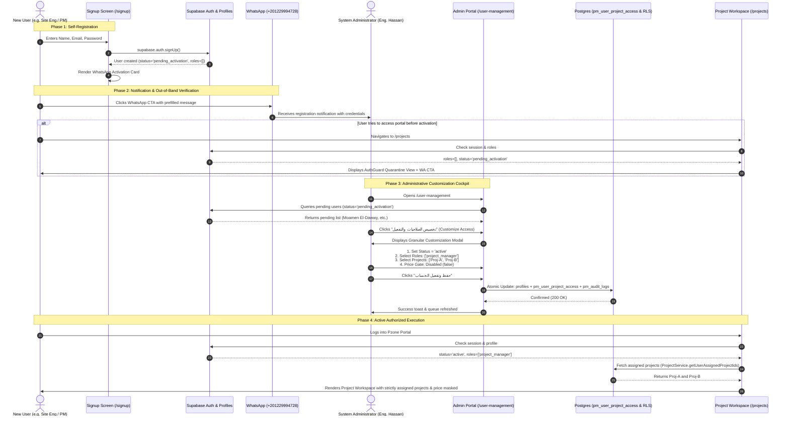
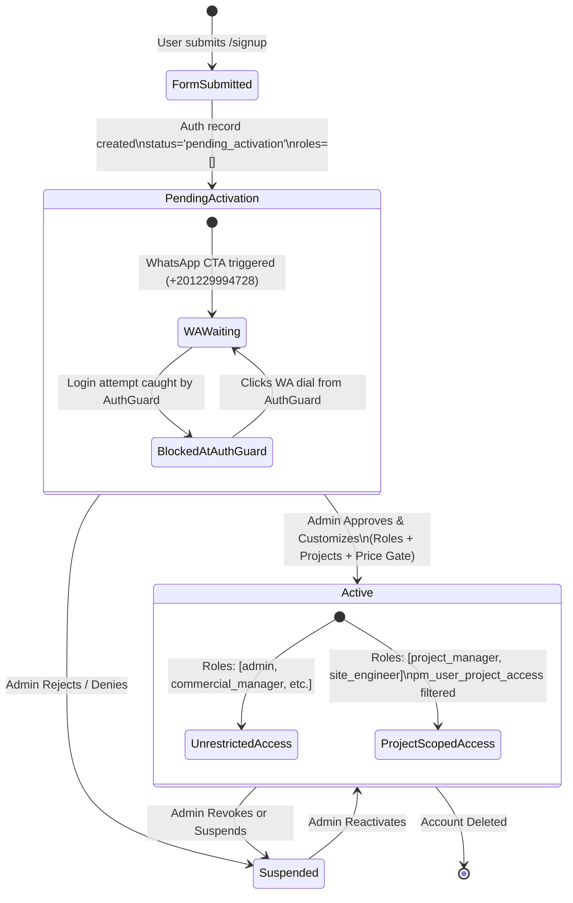

# User Onboarding & Access Customization Workflow
## Document ID: WKF-2026-004
## Architecture Pattern: Zero-Trust Procedural Access Graph

---

## 1. Complete Workflow Diagram (Mermaid)

---

## 2. User Lifecycle State Machine

---

## 3. Procedural Execution Graph (Condition → Guidance → Pitfalls)

### Node 1: Public Registration Submission
- **Condition**: User completes signup form on `/signup` with valid email, strong password, and Arabic/English name.
- **Guidance**: 
  - Execute `supabase.auth.signUp()`.
  - Upon success, do not trigger generic redirection.
  - Persist user contact data in component state.
  - Present the dedicated **Activation Callout Box** displaying WhatsApp link `https://wa.me/201229994728` with pre-encoded credentials.
- **Pitfalls**:
  - *Do NOT* sign the user in as active immediately.
  - *Do NOT* leave user on an empty blank screen without clear confirmation that their request was received.

### Node 2: Zero-Trust Perimeter Check (AuthGuard)
- **Condition**: Any authenticated user navigates to a protected route (`/projects`, `/planning`, `/user-management`, etc.).
- **Guidance**:
  - Inspect `profiles.status` and `profiles.roles`.
  - If status is `pending_activation` OR roles array is empty, block page rendering immediately.
  - Show the centralized **Account Quarantine Card** containing user email and direct WhatsApp button to Admin.
- **Pitfalls**:
  - *Do NOT* rely solely on client-side state. The check must be grounded in server-side session cookies or RLS policies.

### Node 3: Administrative Customization Cockpit
- **Condition**: System Admin accesses `/user-management`.
- **Guidance**:
  - Display counter badge on the **Pending Requests** tab: e.g., `طلبات التفعيل (1)`.
  - When clicking on a user row, open the **Granular Customization Modal**:
    1. **Account Status**: Radio choice (`Active` / `Pending` / `Suspended`).
    2. **RBAC Roles**: 22 Canonical roles checkboxes.
    3. **Project Allocation**:
       - If roles include `admin`, `commercial_manager`, `ceo`, `coo`, default to All Projects.
       - If role is `project_manager` or `site_engineer`, display searchable project list and insert selections into `pm_user_project_access`.
    4. **Price Gate Grant**: Checkbox/Toggle for enabling contract figures visibility.
- **Pitfalls**:
  - *Do NOT* update roles without invalidating TanStack query caches (`admin-profiles`, `admin-user-roles`, `user-roles`).
  - *Do NOT* omit logging the modification in `pm_audit_logs`.
